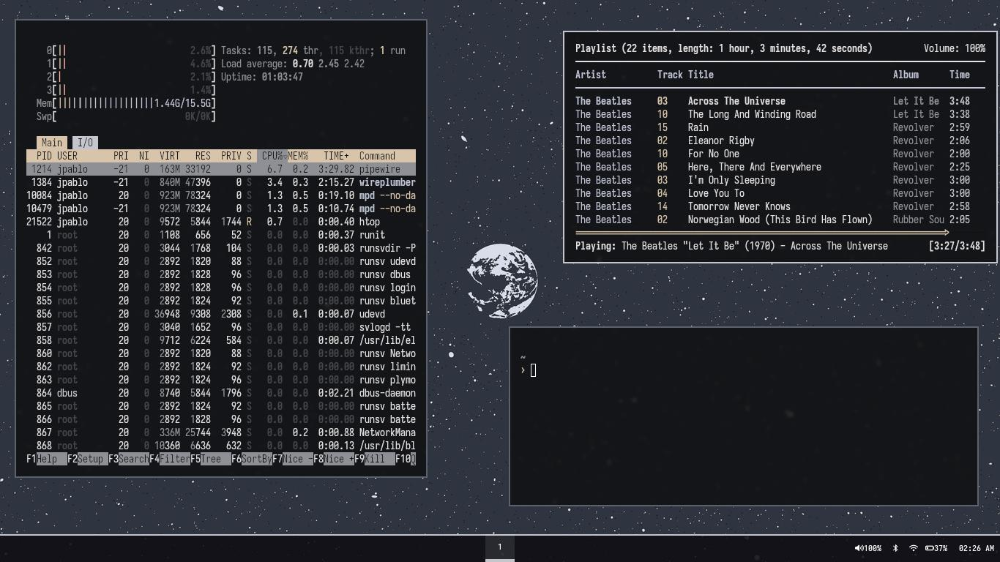
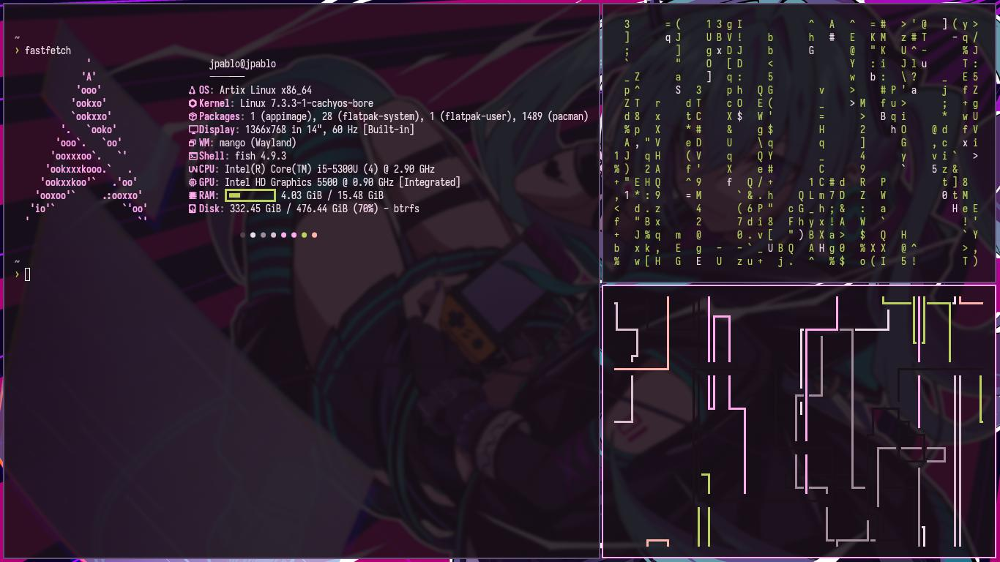
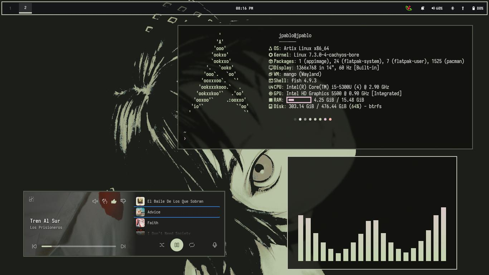
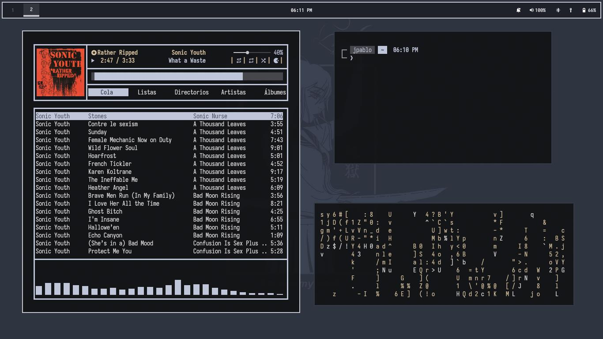

# Dotfiles

Estos son mis dotfiles del wm que esté usando en este momento, para el sol del dia de hoy estoy usando Mangowm, así que esos son los que iré actualizando, pero también tiene mi vieja config de swayfx que es casi lo mismo que la de mango

## Capturas

